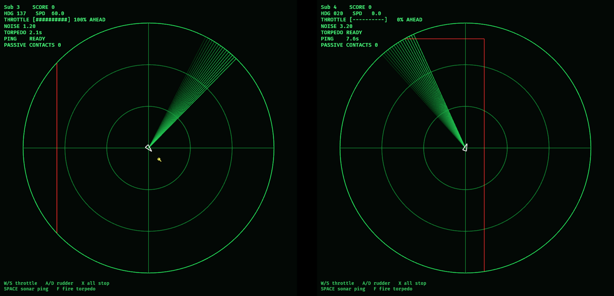

# SubHunt

A 2D top-down multiplayer submarine game written in Rust with [Bevy](https://bevyengine.org/).



You can't see the other players. All you have is a sonar scope:

- **Passive sonar** (always on) tells you the **direction** of anything noisy, but not how far away it is. Going fast makes you louder *and* deafens your own sonar.
- **Active sonar** (`SPACE`) pings: you get an exact **position** for everything in range, but the ping is loud. Everyone nearby now knows where you are, and anyone you pinged is told they've been spotted.
- **Torpedoes** (`F`) run straight ahead and explode within 40 metres of a submarine. Line up a shot using bearings and pings, then sink them before they sink you.

## Quick start

You need a recent Rust toolchain (Bevy 0.20 needs Rust 1.97.1 or newer):

```sh
rustup update stable
```

On Linux you also need a few system libraries ([Bevy's Linux dependency guide](https://github.com/bevyengine/bevy/blob/main/docs/linux_dependencies.md)). On Ubuntu or Debian:

```sh
sudo apt install pkg-config libudev-dev libasound2-dev libx11-dev libxkbcommon-dev libxkbcommon-x11-0 libwayland-dev
```

Then, in three terminals:

```sh
cargo run -p subhunt-server                     # terminal 1: the server
cargo run -p subhunt-client                     # terminal 2: player one
cargo run -p subhunt-client                     # terminal 3: player two
```

To play across a network, run the server on one machine and pass its address to each client:

```sh
cargo run -p subhunt-client -- 192.168.1.20:7777
```

The first build takes a few minutes because it compiles Bevy. Later builds are quick.

No server, or no one to play with? Practice offline against three computer-controlled subs:

```sh
cargo run -p subhunt-client -- --practice
```

### Playing in a web browser

The server also hosts a web version of the game, and browser players join the same match as desktop players.

One-time setup:

```sh
rustup target add wasm32-unknown-unknown
cargo install wasm-bindgen-cli --version 0.2.130   # must match the version in Cargo.lock
```

Build the web client (re-run this whenever you change client code), then start the server:

```sh
./scripts/build-web.sh          # on Windows, run it from Git Bash
cargo run -p subhunt-server
```

Open **http://localhost:8080** and click the scope so it receives the keyboard. Anyone on your network can join at `http://<your-ip>:8080`.

The page downloads about 7 MB (31 MB uncompressed) and needs a browser with WebGL2, which every current browser supports.

The server listens on two ports, and both can be changed:

| Option | Default | Used by |
| --- | --- | --- |
| `--tcp` | `0.0.0.0:7777` | Desktop clients |
| `--web` | `0.0.0.0:8080` | Browsers (web page and WebSocket) |
| `--site` | `web` | Folder the web page is served from |

```sh
cargo run -p subhunt-server -- --web 0.0.0.0:3000
```

## Publishing on GitHub Pages

The repository includes a GitHub Action (`.github/workflows/pages.yml`) that builds the web version and publishes it to GitHub Pages on every push to `main`. The game then appears at `https://<your-user>.github.io/subhunt/`, alongside any other Pages sites you have.

One-time setup: on GitHub, open the repository's **Settings → Pages** and set **Source** to **GitHub Actions**. To publish without pushing, use **Actions → Deploy web client to GitHub Pages → Run workflow**.

GitHub Pages only hosts files; it can't run the game server. So the page decides what to do when it loads:

1. `?practice` in the address always starts a **practice game** against computer subs.
2. Otherwise it connects to a multiplayer server: the one named by `?server=...` in the address, or `window.SUBHUNT_SERVER` in `web/index.html`, or the server the page came from.
3. If no server answers (always the case on Pages until you host one), it switches to **practice** and says so at the top of the screen.

The practice game runs the real game server inside the browser, with computer captains that only see their own sonar, just like you.

### Hosting a multiplayer server

To make the Pages version multiplayer, run the game server on any hosting service that runs Docker containers and supports WebSockets. The repository includes:

- a `Dockerfile` for the server (it listens on the `PORT` variable most hosts set), and
- a `render.yaml` blueprint for [Render](https://render.com), which has a free tier at the time of writing. In the Render dashboard, choose **New → Blueprint** and pick this repository.

Once it's running, point the page at it in either of these ways:

- **Share a link:** `https://<your-user>.github.io/subhunt/?server=wss://<your-server-host>/ws`
- **Make it the default:** set `window.SUBHUNT_SERVER = "wss://<your-server-host>/ws";` in `web/index.html` and push.

Use `wss://` (secure WebSockets), because GitHub Pages is served over HTTPS and browsers block insecure connections from secure pages. Hosting services provide the HTTPS for you.

### Controls

You command the boat from an instrument panel. Everything on it works with a mouse, a finger, or both thumbs at once:

| Control | What it does |
| --- | --- |
| **THROTTLE** lever | Drag up for ahead, down for astern. It stays where you leave it, and snaps to STOP near the middle. |
| **RUDDER** lever | Drag left to turn to port, right to turn to starboard. It springs back to the centre when you let go. |
| **FIRE** button | Launches a torpedo straight ahead. The lamp turns green when the next one is loaded. |
| **PING** button | Active sonar ping. The lamp turns green when it's ready again. |

The keyboard works too:

| Key | Action |
| --- | --- |
| `W` / `S` (or arrow keys) | Throttle up / down (the lever stays where you leave it) |
| `A` / `D` (or arrow keys) | Rudder left / right (only while held) |
| `X` | All stop |
| `SPACE` | Active sonar ping |
| `F` / `Enter` | Fire torpedo |
| `M` | Mute or unmute sound |

On a phone held upright, the panel rearranges itself into a tall layout.

### Reading the panel

**Sonar screen** (the big round one):
- **White arrowhead** in the centre: you. The screen is north-up.
- **Amber lines**: passive bearings to submarines. Brighter means clearer.
- **Red lines**: passive bearings to enemy torpedoes. Turn and run!
- **Green circles**: ping echoes (exact positions). They fade over six seconds.
- **Yellow dots**: your own torpedoes.
- **Dark red edge**: the boundary of the play area.

**Gauges:**
- **SPEED ×10:** your speed. "6" means 60.
- **Heading:** a compass. The plate underneath shows the exact bearing.
- **NOISE:** how loud you are. In the orange zone you can be heard from a long way off.

**Warning lamps:** PINGED flashes when someone's ping finds you. HEARD lights while your sonar can hear something. HIT means your torpedo sank someone. SUNK means you were sunk.

**Message display:** the game mode on the top line, and the latest event below it.

### Sound

Every sound is synthesised by the game itself, so there are no audio files:

- **Ping:** your active sonar. Each echo comes back as a softer blip, delayed by how far away the target is (sound travels about 1,500 metres a second in water), so distant contacts answer later and quieter.
- **Torpedo launch:** a thump, a rush of water and bubbles.
- **Engine:** a low rumble that gets louder and higher as you speed up.
- **Hull:** the occasional creak and groan.

In a browser, sound starts after your first tap or key press, because browsers keep pages silent until then.

## Running the tests

```sh
cargo test --workspace
```

The game rules, server logic and client logic are all tested without opening a window or a socket. That's one of the payoffs of the architecture.

## Project layout

```
crates/
  domain/        Game rules: submarines, sonar, torpedoes. No dependencies at all.
  application/   Use cases (GameServer, ClientSession) and ports (transport traits).
  protocol/      Wire format: JSON messages shared by both network adapters.
  net-tcp/       Network adapter: the ports over TCP (desktop clients).
  net-ws/        Network adapter: server side over WebSockets, and serves the web page.
  net-browser/   Network adapter: client side using the browser's WebSocket (WebAssembly only).
  server/        Headless server binary (no Bevy needed).
  client/        Bevy client binary: the instrument panel. Builds for desktop and web.
scripts/
  build-web.sh   Builds the browser version into web/pkg.
.github/workflows/
  pages.yml      Publishes the web version to GitHub Pages.
Dockerfile       Container image for hosting the multiplayer server.
web/
  index.html     The web page that hosts the game.
docs/
  ARCHITECTURE.md   How it fits together, and a Rust primer for this codebase.
```

**New to Rust or hexagonal architecture?** Read [docs/ARCHITECTURE.md](docs/ARCHITECTURE.md). It walks through how the layers fit together, follows one keypress all the way to the screen, and explains the Rust features as they come up.
